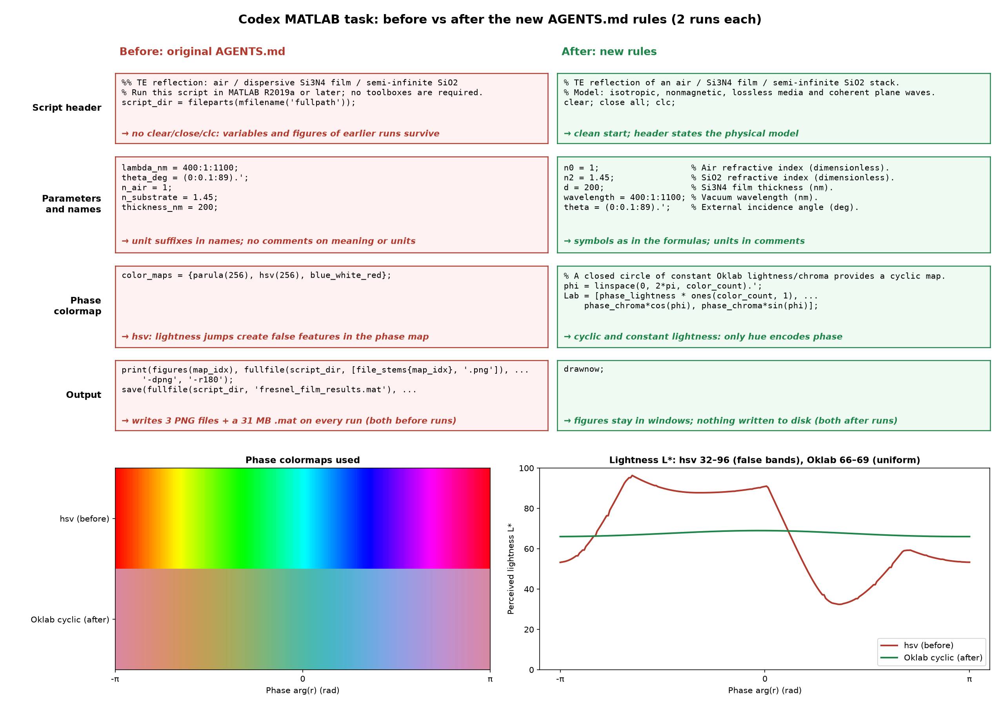
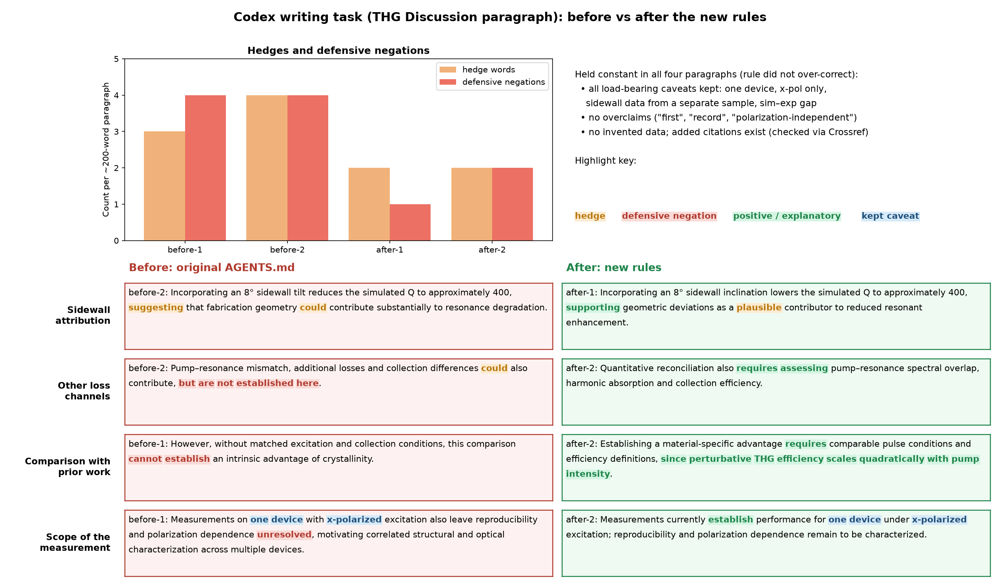

# agent-rules: 科研代码与写作全局规则For Codex/Claude Code

主要解决问题：大模型的“防御性编程”&“防御性写作”

``` 
- 防御性编程：到处加 try/catch、静默兜底、对自己写死的常数做检查。规则要求出错直接报错，不吞错误，不用默认值掩盖问题。
- 防御性写作：论文里堆 may、could，写 "cannot establish" 这类提前辩解的句子。规则要求去掉多余的辩解，保留近似条件、适用范围、单器件等必要的限定。
```

同时规定了科研代码脚本的默认风格：写成平铺的脚本、不导出文件只弹图窗、变量名对应公式符号、按数据性质选色表、注释用英文、脚本默认不保存数据、运行时间超过 5 分钟先问、MATLAB 脚本开头加 `clear; close all; clc;`等等，覆盖 Python、MATLAB、Mathematica三种语言。

## 文件内容

| 文件 | 内容 |
|---|---|
| [AGENTS.full.md](AGENTS.full.md) | for codex，含个人的工作流设定 |
| [research-coding-writing.md](./research-coding-writing.md)  | for claude code |

## 使用方法

优先采用追加方式使用文档；不要覆盖AGENTS.md或者CLAUDE.md，否则会破坏你自己已有的规则。

- **Codex**：把 [research-coding-writing.md](research-coding-writing.md) 的内容追加到 `~/.codex/AGENTS.md` 末尾；[AGENTS.full.md](AGENTS.full.md) 包含更多个人工作流设定，仅供参考。
- **Claude Code**：将 [research-coding-writing.md](research-coding-writing.md) 复制到 `~/.claude/rules/research-coding-writing.md`。

修改后新建会话，再检查规则是否加载。

## 测试归档

在 Codex 中，对 MATLAB 薄膜反射脚本和英文 THG Discussion 两个任务，安装规则前后各运行两次。完整的 [测试材料](examples/ab-test/README.md) 包括 prompt、输入数据、全部生成代码与文本、规则版本及评分记录。

- **代码**：before 两次都导出了 3 张 PNG 和一个约 31 MB 的 `.mat`，相位图用了 hsv；after 两次均不导出这些文件，改用 cyclic 色表，变量单位改写在注释里。
- **写作**：措辞更直接，单器件、单偏振和间接结构证据等必要限定仍保留。词频只是文本特征，不是写作质量评分。

本轮只有每组两次、每类一个任务，没有盲评，也没有测试 Claude Code。输入折射率表和 THG 情境均为人为构造，不是本仓库的实验数据；测试之后新增的三条规则尚未验证。原报告有一处叠加 hedge 的误记，词表也在事后扩大过，详见 [复核更正](examples/ab-test/reports/archive-notes.md)。

### 代码对比



### 写作对比



图片保留最初展示版本，摘录不代表全部结果；计数与措辞的边界请结合复核更正阅读。

## 许可

[MIT](LICENSE)
